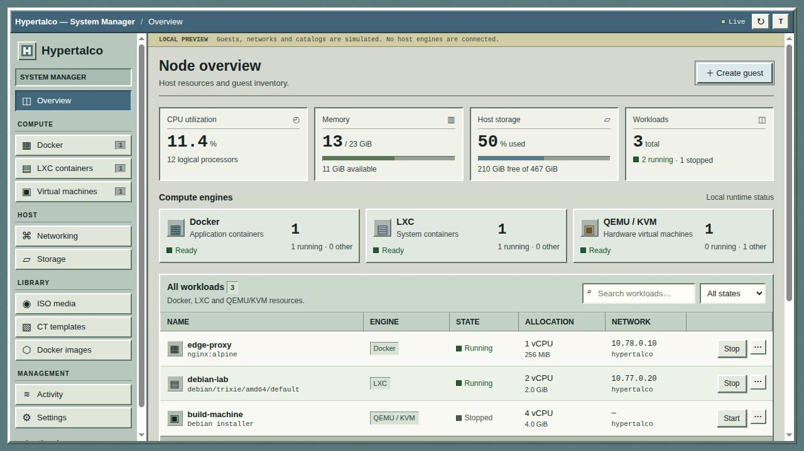

# HyperTalco

Administrá **Docker, LXC y máquinas virtuales QEMU/KVM** desde un panel web en tu propio servidor Debian o Ubuntu. Instalás los tres motores sobre el sistema que ya tenés y seguís usando los repositorios de la distribución para actualizarlos. HyperTalco es software libre con licencia MIT y funciona sin suscripción ni cuenta en la nube.



*Vista de demostración. El panel reúne el estado de los motores, el consumo de recursos y el inventario de invitados.*

## Instalación rápida · v1.0.0

Necesitás un host con systemd, cgroup v2, virtualización habilitada en firmware, KVM operativo, acceso root, conexión a los repositorios y al menos **10 GiB libres en el filesystem de `/var/lib`**. Para un primer laboratorio recomendamos 4 hilos de CPU, 8 GiB de RAM, disco de sistema de 32 GiB y espacio adicional para los invitados.

El instalador admite Debian 12/13 y Ubuntu 22.04/24.04/26.04 en x86_64 o aarch64. **La instalación física verificada fue Ubuntu Server 24.04.5 x86_64**. La cobertura de las demás combinaciones figura en la [guía de pruebas](docs/TESTING.md).

1. Prepará un backup o snapshot recuperable. Si la raíz está en LVM y el arranque está en particiones separadas, el snapshot de raíz excluye `/boot` y EFI.
2. Desde una terminal del servidor, ejecutá el instalador interactivo de la versión que querés instalar.

   ```bash
   curl -fsSL https://raw.githubusercontent.com/MundoFacu/hypertalco/v1.0.0/hypertalco-installer.sh | sudo bash -s -- --repo MundoFacu/hypertalco --version 1.0.0
   ```

3. Revisá las subredes, los directorios de invitados, ISO y templates, y el puerto HTTPS. **Enter** acepta cada valor sugerido. El asistente muestra el plan y los controles del host antes de pedir **INSTALL** y la contraseña web de al menos 12 caracteres.
4. Abrí **`https://IP-DEL-SERVIDOR:8443/`** e ingresá como **talcoadmin**. La instalación inicial genera un certificado autofirmado. Usá la interfaz desde una red de administración de confianza.

Para inspeccionar las opciones antes de instalar, desde una copia del código ejecutá `bash hypertalco-installer.sh --plan`. La [guía de instalación](docs/INSTALL.md) explica cada pregunta, los valores por defecto, las rutas y los servicios.

## Tu primer invitado

| Qué querés correr | Por dónde empezar |
|---|---|
| **Una VM desde ISO** | En **Library → ISO media**, elegí **Upload ISO** desde el navegador o **Import ISO** desde una URL o ruta montada en el host. En la tarjeta de la ISO, pulsá **Create VM**, asigná CPU, RAM y disco y abrí **Open console** para instalar el sistema por noVNC. |
| **Un contenedor de sistema LXC** | Abrí **CT templates**. Elegí una plantilla oficial o subí un rootfs Debian/Ubuntu en `.tar.xz`, `.tar.gz` o `.tar.zst`. Creá el CT con tu clave pública SSH. Los CT se ejecutan sin privilegios. |
| **Una aplicación Docker** | En **Docker images** buscá en Docker Hub o descargá una imagen por nombre y etiqueta. Al crear el contenedor podés configurar puertos, variables y un volumen persistente. |

## Administración y alcance

El panel reúne métricas del host, logs, actividad y auditoría. Podés iniciar y detener invitados, ajustar CPU y memoria con el invitado detenido y configurar redes NAT, aisladas o un bridge existente según el motor. El instalador conserva la dirección de administración del host. Un agente root ejecuta operaciones acotadas por un socket local. El servicio web usa una cuenta de sistema sin login y el administrador trabaja desde el panel sin ingresar sudo en cada operación.

**Límites de la versión 1.0.0.** La administración abarca un host. Clustering, alta disponibilidad, migración en vivo, backups programados y gestión de VLAN o bonds quedan fuera del alcance. Los invitados creados por otras herramientas aparecen en modo lectura. Para usar un share como origen de ISO, montalo primero en Linux. El rollback del instalador es parcial y puede dejar paquetes, redes o datos creados.

## Probar el panel sin instalar los motores

Desde una copia del repositorio, con Python 3.10+ y un usuario normal:

```bash
python3 -m hypertalco dev --port 8768 --data-dir /tmp/hypertalco-preview
```

Abrí `http://127.0.0.1:8768/`. La demo simula los invitados y usa las credenciales de ejemplo `talcoadmin` / `hypertalco-preview-only`.

[Instalación](docs/INSTALL.md) · [Redes](docs/NETWORKING.md) · [Seguridad](docs/SECURITY.md) · [Arquitectura](docs/ARCHITECTURE.md) · [Pruebas](docs/TESTING.md) · [Licencia MIT](LICENSE)

**cooked in vibetool.cloud sauce**
